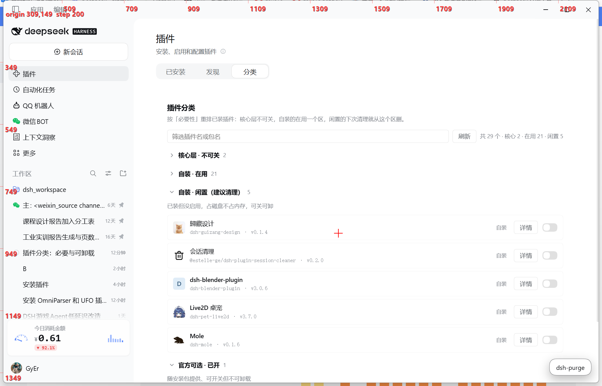
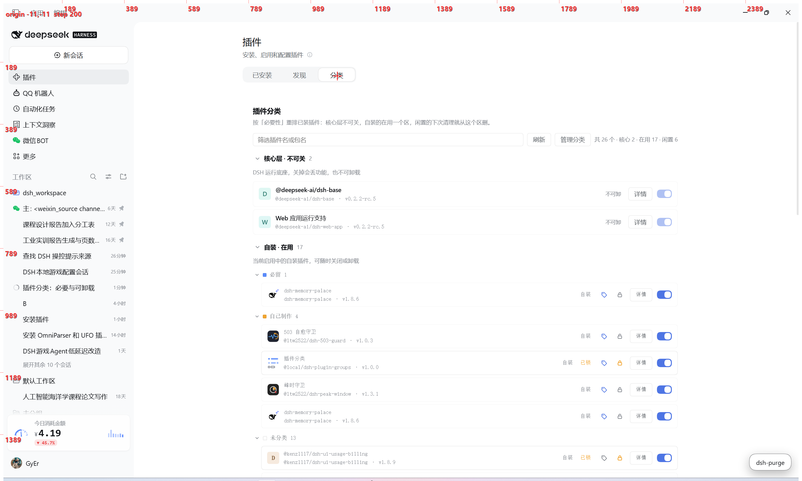
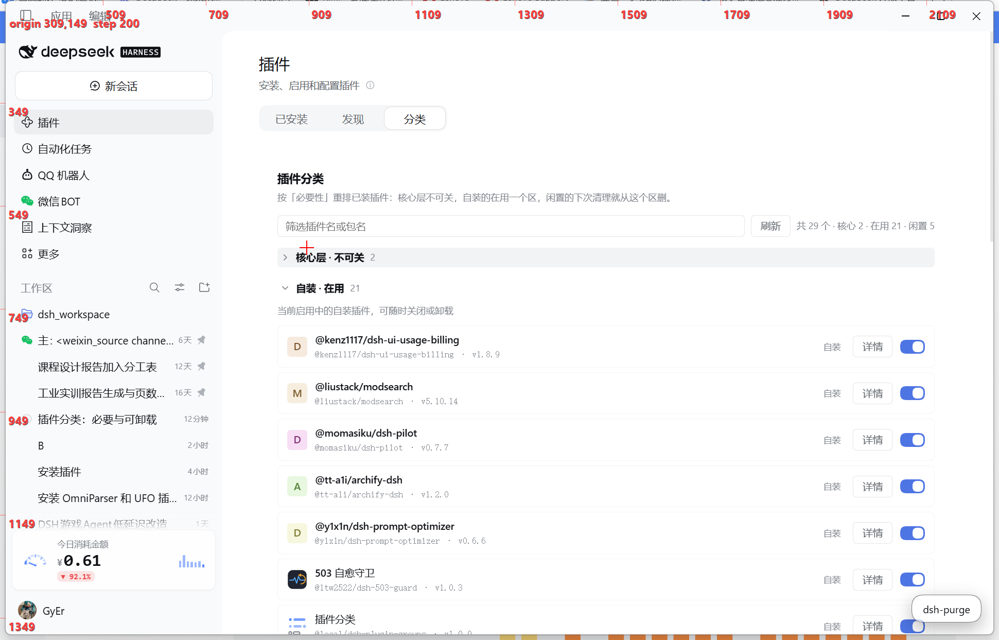
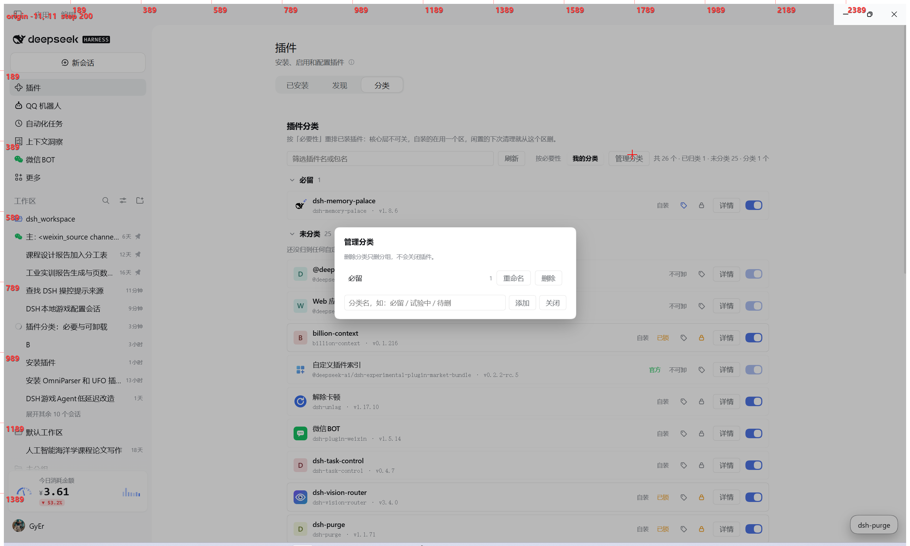
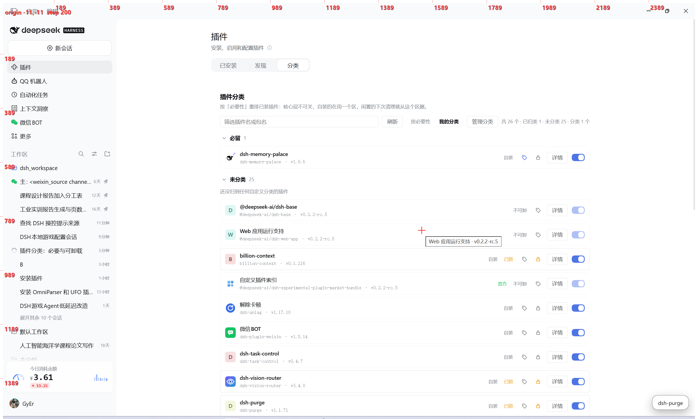
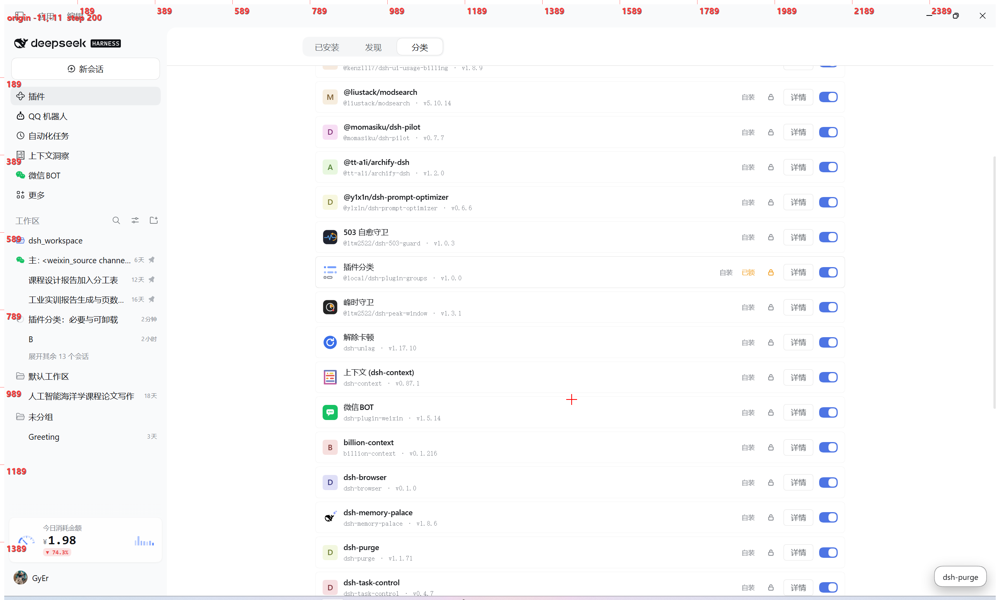

# 插件分类：把已装插件按「必要性」重新分组

DSH 装了几十个插件之后，「已安装」页是一条平铺长列表：底座、官方可选、自己装的、
装了没启用的、文件已经坏掉的，全混在一起。想清理一个闲置插件，得先在下拉里翻半天。

这个插件在「插件」页加一个并列的 **分类** 页签，按客观字段把插件分成五区，并支持
就地开关、折叠分区、自建二级分组。

## 分成哪五区

判据全部取自 Host 报的 `BundleInfo`（`installed` / `official` / `removable` /
`enabled` / `readOnlyReason` / `availability`），不维护第二份清单，装完删完自动跟随。

| 分区 | 判据 | 含义 |
| --- | --- | --- |
| 核心层 · 不可关 | `installed=false && removable=false && official=false && enabled=true` | DSH 运行底座，关掉丢功能 |
| 自装 · 在用 | `installed=true && enabled=true` | 当前启用的第三方 bundle |
| 自装 · 闲置（建议清理） | `installed=true && enabled=false` | 装了没启用，清理候选 |
| 官方可选 · 已开 | `official=true && installed=false && enabled=true` | 随安装包提供，可开关不可卸载 |
| 异常 · 需要处理 | `availability='missing'` 且本来在用 | 文件缺失或加载报错 |

`classify()` 返回 `null` 的条目（例如关着的官方可选插件）不进本页，避免和内置
「实验性插件」区重复。

## 为什么是新增页签，而不是改内置页

内置「已安装」页的渲染逻辑在 `@deepseek-ai/dsh-client-ui-plugin-manager/lib/client.js`
里，是一份压缩过的构建产物，列表被硬编码成三个 `renderGroup`，slot 契约也没有
「往列表中间插分区」的挂点。改它只有两种结果：打补丁（每次升级被覆盖）或者改不动。
本插件走官方 `plugins.tab` 插槽，贡献一个并列的新页签，内置页一行不改，升级不丢。

## 交互

- 顶部输入框按标题或包名筛，右侧汇总「共 N 个 · 核心 a · 在用 b · 闲置 c」
- 每个分区可点标题折叠（折叠状态只存内存）
- 行内开关直接调 `pluginManager.setBundleEnabled` 写 profile；`readOnlyReason` 存在
  或 `removable=false` 的行置灰
- 「详情」调宿主 `openPackage(name)`，返回时自动回到「分类」页签
- 订阅 `plugin-manager/changed`，别处安装/卸载/开关后本页自动重读

## 自建二级分组（仿 Steam 游戏库）

分类不是另一套视图，而是嵌在必要性分区**内部**的二级文件夹：

- 新建/重命名/删除分组，每个分组自动分配一种颜色
- 拖插件进分组，同一插件可留在「未分组」里
- 分组可以锁定（防止误拖），锁定状态有提示气泡

## 更多截图

| | |
| --- | --- |
|  |  |
|  |  |

详细设计说明见 [docs/DETAIL.md](docs/DETAIL.md)。

## 许可

MIT
