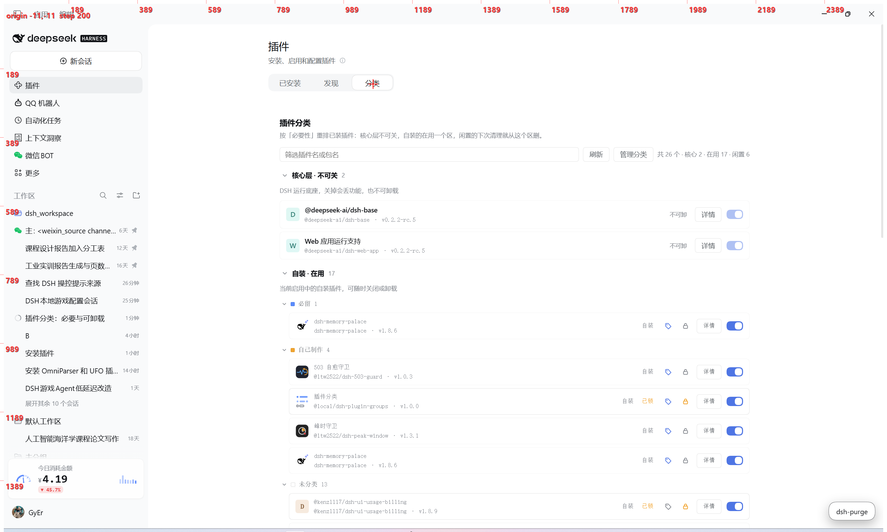

# 插件分类（@local/dsh-plugin-groups）

在 DeepSeek Harness 的「插件」页里新增一个 **分类** 页签，把已装插件按「必要性」重新分组，并支持就地开关。

## 为什么不是直接改内置页

内置「已安装」页的渲染逻辑在 `@deepseek-ai/dsh-client-ui-plugin-manager/lib/client.js` 里，是一份单行压缩的构建产物；它的页面结构把列表硬编码成三个 `renderGroup`（内置插件配置 / 实验性插件 / 已安装插件），slot 契约也没有提供「往已安装列表中间插入分区」的挂点。因此改内置页只有两种结果：打补丁（每次升级被覆盖）或者改不动。

本插件走官方 `plugins.tab` 插槽，贡献一个**并列的新页签**，内置页一行不改，升级不丢。

## 分成哪五区

判据全部取自 Host 报的 `BundleInfo` 客观字段（`installed` / `official` / `removable` / `enabled` / `readOnlyReason` / `availability`），不维护第二份清单，装完、删完自动跟随。

| 分区 | 判据 | 含义 |
| --- | --- | --- |
| 核心层 · 不可关 | `installed=false && removable=false && official=false && enabled=true` | DSH 运行底座（如 `@deepseek-ai/dsh-base`、`dsh-web-app`），关掉丢功能，也不可卸载 |
| 自装 · 在用 | `installed=true && enabled=true` | 当前启用的第三方 bundle，可随时关或卸 |
| 自装 · 闲置（建议清理） | `installed=true && enabled=false` | 装了没启用：占磁盘不占内存，是清理候选 |
| 官方可选 · 已开 | `official=true && installed=false && enabled=true` | 随安装包提供、可开关但不可卸载 |
| 异常 · 需要处理 | `availability='missing'` 且本来在用或被启用 | 文件缺失或加载报错 |

`classify()` 返回 `null` 的条目（例如关着的官方可选插件）不进本页，避免与内置「实验性插件」区重复。

## 交互

- 顶部输入框按标题或包名筛，右侧汇总「共 N 个 · 核心 a · 在用 b · 闲置 c」。
- 每个分区可点击标题折叠，折叠状态只存内存。
- 行内开关直接调 `pluginManager.setBundleEnabled`，写 profile；`readOnlyReason` 存在或 `removable=false` 的行置灰。
- 「详情」调宿主 `openPackage(name)`，会切到内置详情页，返回时自动回到「分类」页签。
- 订阅 `plugin-manager/changed`，别处安装/卸载/开关后本页自动重读。

## 自定义分类（仿 Steam 游戏库，二级文件夹）

分类不再是另一套视图，而是**嵌在必要性分区内部的二级文件夹**。进「分类」页后，每个分区（核心层 / 自装·在用 / 闲置 …）下面会多出一层可折叠的小分组：

```
▾ 自装·在用  17
   ▾ ■ 必留        2      ← ■ 是该分类的颜色（每个分类自动分配一种）
       dsh-memory-palace
       dsh-vision-router
   ▾ ■ 自己制作    5
       503 自愈守卫
       插件分类
       …
   ▾ ⬚ 未分类      9      ← 虚线方框 = 没归任何分类
```

- **折叠**：二级分组标题本身就是折叠按钮，三角旋转 90° 表示展开，和一级分区头一致。
- **颜色**：每个分类按建立顺序从 8 色调色板（`CAT_COLORS`）里取一种，二级头左侧的 8×8 色点和行内标签图标的蓝/灰两态相互对应。
- **不可卸载的插件（核心层、官方可选）完全不进收藏夹**：行内既没有标签图标，也不会出现在任何文件夹里（连「未分类」都不进），直接平铺在分区下面。判据是 `bundle.removable !== false`，`Section` 里叫 `plain` 这一路。
- **空分类**只在「自装·在用」区露头，核心层/闲置区里不重复挂空文件夹（那是噪音）。
- **一件插件可属多个分类**，于是会在多个文件夹里各出现一次（和 Steam 一个游戏能挂多个分类一致）；一个都没归的进「未分类」，排最后，没内容时不占位。

- **给插件归类**：点行内标签图标（锁图标左边）→ 弹出「设置分类」，勾选即保存，可多选。
- **建分类**：对话框底部输入名字 → 添加；若正在给某插件归类，新建的分类会**顺手挂给当前这件**。
- **管理分类**：工具栏「管理分类」常驻入口，可改名、删除；删除只删分组，不动插件开关。

数据只存在浏览器 `localStorage`（键 `pluginGroups.categories.v1`），形状是 `{ cats: [{id,name,color}], map: { 包名: [分类 id] } }`。不动 Host、不改 profile，所以换浏览器/清缓存会丢，重装插件不受影响。删分类时会同步清掉各插件对它的引用；`readCats()` 还会丢弃指向已不存在分类的 id，读到脏数据也不炸。



## 锁定（防误关）

每个「自装」行右侧有一个锁图标（在「详情」左边），点一下就把这一行锁住：

| 状态 | 视觉 | 点行内开关时 |
| --- | --- | --- |
| 未锁 | 灰色开口锁 | 正常开/关 |
| 已锁 | 橙色闭合锁 + 「已锁」标签 + 行底色加深 | **拒绝关闭**，顶部弹橙色提示条「「包名」已锁定，先点它左边的锁图标解锁，才能关闭」 |

设计取舍：

- **只有可卸载的行才有锁**。核心层（`removable=false`）和官方可选插件的开关本来就置灰，再摆一个锁只是噪音，所以这几行不渲染锁按钮，也不会出现「已锁」标签（`lockable = bundle.removable !== false`）。
- **「插件分类」启用后自动锁自己**。关掉自己的页签就没了，这是最容易手滑的一格。首次运行时写入 `pluginGroups.autoLockSelf.v1` 标记并把 `@local/dsh-plugin-groups` 加进锁定清单；标记写成之后就不再干预，你手动解锁它也不会被强行锁回去。
- **锁只拦「关闭」，不拦「开启」**。锁的目的是防手滑把自己正在用的插件点掉；正在跑的东西再点开一次没有意义，不需要先解锁。
- 锁定状态存在浏览器 `localStorage`（键 `pluginGroups.locked.v2`），不写 profile、不碰 Host —— 它是显示层偏好，不是插件配置。换浏览器/清缓存会丢，重装插件不受影响。
- 锁定不阻止你在内置「已安装插件」页关它；要真正拦住所有入口，得改 Host 侧策略，超出本页签的职责。
- 键名带版本号：升版即丢弃旧版遗留数据。

验证记录（`docs/preview-lock-tag.png`、`docs/preview-lock-notice.png`、`docs/preview-lock-autoself.png`）：给 `@local/dsh-plugin-groups` 上锁 → 行变橙标「已锁」→ 点它自己的开关 → 开关保持蓝色不被关闭，顶部出现橙色提示条；点提示条右侧 `×` 可关掉提示，锁依然有效。重载页面后自动锁复现，「核心层」两行确认没有锁按钮。

## 安装与卸载

```powershell
# 在 DSH GUI 的「插件 → 发现 → 添加插件」里选本地目录，或走 plugin_manager 工具
# 目标目录：D:\dsh_workspace\dsh-plugin-groups
```

卸载即在内置「已安装插件」列表里关掉或移除本 bundle —— 本插件自身也会出现在「自装 · 在用」区里，可以自己关自己（关闭后页签消失）。

## 文件

- `index.js` — Host 半边，空实现，只为让 bundle 在 Loader 里可开关、可卸载。
- `client.js` — 浏览器半边：注册 `pluginGroups` 字典、订阅 Host 变更、注册 `plugins.tab` 页签。
- `cordis.patch.yml` — bundle 补丁，把本插件插进 Loader。
- `locale/zh.json`、`locale/en.json` — 插件元信息（标题、描述）。
- `icon.svg` — 三条分组行，分别对应核心层（实心）、在用（半透明）、闲置（描边）。

## 实测验证（desktop profile，DSH 0.2.2-rc.5）

- 页签出现在「插件」页顶部分段：`已安装 / 发现 / 分类`。
- 首屏汇总：`共 29 个 · 核心 2 · 在用 21 · 闲置 5`。
- 核心层两行 `@deepseek-ai/dsh-base`、`Web 应用运行支持` 带「不可卸」标签，开关置灰不可点。
- 自装 · 闲置区命中 5 个：`歸藏设计`、`会话清理`、`dsh-blender-plugin`、`Live2D 桌宠`、`Mole`，均为已安装且已关闭。
- 点标题可折叠/展开（鼠标点击与键盘 Enter 都可）；点行内「详情」跳到内置包详情页；开关写回 profile 后本页自动重读。
- 没有 icon 的第三方 bundle 用「首字母色块」兜底（去掉 `@scope/` 前缀取首字），有 `meta.icon` 的直接渲染 data URL。

## 已知边界

- 分组是**视图层重排**，不改内置「已安装」页的排序，也不改任何插件的启用状态。
- 「必要 / 可卸」的判定跟着 `removable` 与 `readOnlyReason` 走；如果某个第三方插件把自己声明成不可卸，它会被归到「核心层」以外但同样置灰不可关，具体看该行的标签。
- 折叠状态只存在内存里，重载页面后回到全部展开。
- 「详情」复用宿主 `openPackage`，因此会离开本页签；返回时靠 `returnTab` 回到「分类」。
